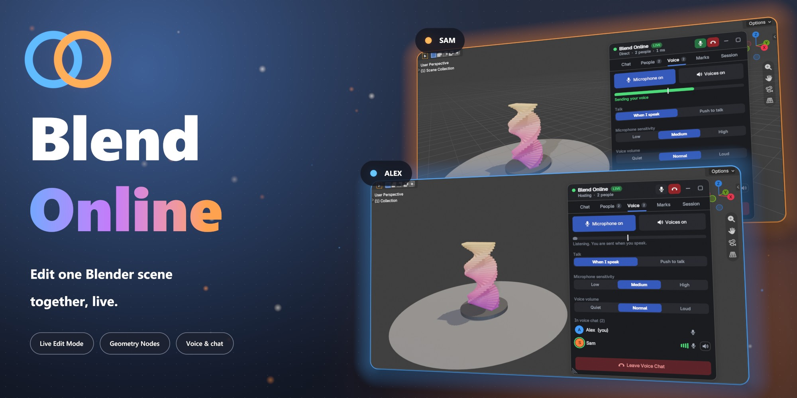

# Blend Online – product page

Product page and documentation for the **Blend Online** Blender add-on. This repository holds only the description, documentation and media, not the add-on itself.

- Product page: `index.html`, served with GitHub Pages at https://blenderprocedural.github.io/blend-online/
- Documentation: `docs.html`, served at https://blenderprocedural.github.io/blend-online/docs.html
- Images: `images/` (screenshots, cover, logo)
- Video: `media/promo.mp4` (full promo with sound) and short silent loops `media/*.mp4`
- Shared style and iframe helper: `assets/`. Fonts (Inter) are bundled in `fonts/`, so the pages make no external requests.

Both pages work inside an iframe. Links to other pages open in a new tab, and the page posts its height to the parent window (`{type: "blend-online-height", height}`).

